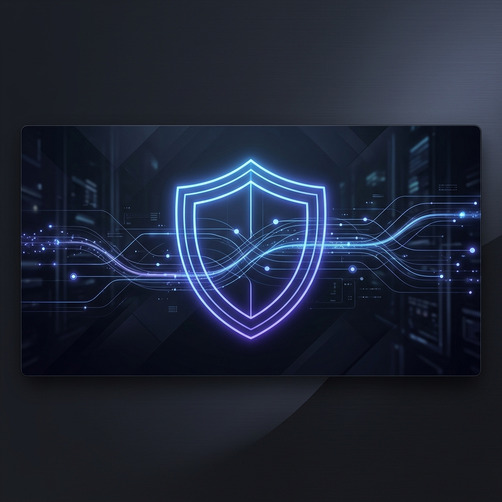

# Freenet (macOS)

<p align="center">
  
</p>

<p align="center">
  <a href="https://img.shields.io/badge/Platform-macOS%2013.0+%20(Universal)-apple?style=flat-square&logo=apple"></a>
  <a href="https://img.shields.io/badge/Version-1.2.1-orange?style=flat-square"></a>
  <a href="https://img.shields.io/badge/Swift-5-F05138?style=flat-square&logo=swift&logoColor=white"></a>
  <a href="https://img.shields.io/badge/License-MIT-green?style=flat-square"></a>
</p>

<h3 align="center">Free. Open. Intent-based. Censorship bypass <em>or</em> real anonymity — you choose.</h3>

Freenet is a **zero-configuration**, native SwiftUI internet freedom tool for macOS (Apple Silicon & Intel Universal Binary). It lives in the menubar, connects with a single click, and never blurs the line between speed, IP masking, and anonymity. **macOS only.**

🇹🇷 **[Türkçe README](README.tr.md)** · 📋 **[Roadmap](ROADMAP.md)** · 🛡️ **[Threat Model](docs/THREAT_MODEL.md)** · 🔧 **[Build Guide](docs/BUILD.md)**

---

## Three Intents (Honest Tradeoffs)

Freenet does **not** promise "full speed + full anonymity" in a single switch. You pick an explicit **intent**:

| Intent | Engines | What it protects | What it does **not** protect |
|--------|---------|------------------|------------------------------|
| **Hızlı** (Fast) | **sing-box** (`Hibrit Zırh`: sing-box + `ciadpi`, or pure TLS/TCP fragment) | Full ISP wire-speed DPI/SNI/HTTP-80 bypass + encrypted DoH DNS shield (malware/ad blocking) + QUIC/BTK sinkhole blocking | Does **not** hide your IP; not anonymous |
| **Dengeli** (Balanced) | **WARP** (`sing-box` native WireGuard default, or full-device `wg-quick` L3 tunnel) | Masks IP, bypasses IP bans, routes DoH inside WARP, multi-IP/port failover (`500`/`4500`/`1701`/`2408`) + `MTU 1380` | **Not anonymous** — Cloudflare sees your real IP and destinations |
| **Maks. Gizlilik** (Max Privacy) | **Tor** (+ optional `obfs4`/`snowflake` bridges) | Real multi-hop anonymity with live `check.torproject.org` verification | High speed; some sites block Tor exit nodes |

> **Real anonymity is only Maks. Gizlilik (Tor).**  
> WARP is free IP masking under a **single-operator trust model (Cloudflare)**, not anonymity.

---

## What's Inside (v1.2.0)

### Hardened Hızlı (VPN-Free, Wire-Speed)
- **Hibrit Zırh (`sing-box 1081 → ciadpi 1082`)** *(default)*: Combines `sing-box` encrypted DoH, `HTTPS`/`SVCB` + QUIC/UDP:443 blocking, DNS `port 53` hijack, and BTK/sinkhole IP rejection (`195.175.254.2`, `0.0.0.0/8`) with `ciadpi`'s 3-tier automatic DPI desync (`-r 1+s`, `-s 1+s`, `-d 1`, HTTP:80 Host obfuscation `-M h`, `-L 3` auto-sorting, 1-hour IP cache).
- **3 Anti-DPI modes in Settings:** `Hibrit Zırh`, `TLS Record (Hızlı)`, and `TCP Fragment (Sert DPI)`.
- **5 Encrypted DoH DNS Shields with Auto-Failover:** Cloudflare Security (`1.1.1.2` malware block), AdGuard Shield (`94.140.14.14` ad+tracker+malware block), Cloudflare Fast (`1.1.1.1`), Quad9 (`9.9.9.9`), and Google (`8.8.8.8`), plus `4096` DNS cache and local `.local`/`.test`/LAN bypass.
- **Mixed Proxy (`SOCKS5 + HTTP + HTTPS`):** Single localhost port (`127.0.0.1:1081`) with dynamic network interface discovery (`Wi-Fi`, `USB LAN`, `Ethernet`) and optional LAN bypass domains.

### Upgraded Dengeli (Dual-Transport WARP)
- **`sing-box WARP` *(default, recommended)*:** Native WireGuard inside bundled `sing-box` (`127.0.0.1:1083`) — no root, no `utun` route hijack (never breaks local dev servers or `cloudflared` tunnels), automatic sequential IP+port failover (`162.159.193.1` / `162.159.192.1` × `500`/`4500`/`1701`/`2408`) verified live with `warp=on`, plus DoH routed inside WARP.
- **`Sistem Tüneli (wg-quick)`:** Optional full-device L3 `utun` tunnel automatically tuned with `MTU 1380`, `PersistentKeepalive 25`, alternate `162.159.193.1` endpoint, aligned DNS shield, and post-connect `warp=on` check.

### Native macOS Engineering
- **Universal Binary (`arm64` + `x86_64`)** compiled directly via `swiftc` + `lipo`.
- **Zero-subprocess monitoring:** Native Darwin `getifaddrs()`, `CFNetworkCopySystemProxySettings()`, and non-blocking POSIX TCP `connect()` — eliminates background polling churn.
- **Hot-Swap intents:** Switch between Hızlı / Dengeli / Maks. Gizlilik while connected without manual disconnect.
- **Security & hygiene:** SHA-256 verification (`CHECKSUMS.sha256`), SHA-256 verified in-app self-updater (GitHub Releases `.zip` + `.sha256`, HTTPS origin allowlist, atomic swap + rollback), strict `DPIArgsValidator` flag allowlist + mandatory `127.0.0.1` localhost bind, narrow fixed-template sudoers, self-heal, and orphan proxy cleanup.

---

## Build & Run from Source

```bash
git clone https://github.com/Baro007/freenet.git
cd freenet/app
./Tests/run_tests.sh   # 88 pure-logic tests against shipped sources
./build.sh             # Builds Universal macOS app: build/freenet.app
open build/freenet.app
```

**Requirements:** macOS 13+, Xcode Command Line Tools (`swiftc`).

- **Hızlı (sing-box / ciadpi):** Works out of the box (binaries bundled & SHA-256 verified).
- **Dengeli (WARP):** Uses `~/.config/wireguard/wgcf.conf` (auto-generates via `wgcf` if Homebrew `wgcf` is installed).
- **Maks. Gizlilik (Tor):** Requires `tor` (Homebrew `brew install tor` or bundled under `app/Resources/bin/tor`). Freenet **never** fakes a connected Tor state.

See [docs/BUILD.md](docs/BUILD.md) and [install.sh](install.sh) for installation and checksum verification notes.

---

## Trust & Security

- MIT open source — audit every line of Swift (`app/*.swift`).
- No telemetry, no analytics, no accounts, no paid tiers.
- System proxy (`networksetup`) is the current path; Network Extension roadmap is documented in [ROADMAP.md](ROADMAP.md) and [docs/NETWORK_EXTENSION.md](docs/NETWORK_EXTENSION.md).
- Read [docs/THREAT_MODEL.md](docs/THREAT_MODEL.md) before relying on any mode for high-risk scenarios.

---

## Credits

- [sing-box](https://github.com/SagerNet/sing-box) · [ciadpi / ByeDPI](https://github.com/hufrea/byedpi) · [WireGuard](https://www.wireguard.com/) · [Cloudflare WARP](https://1.1.1.1/) · [Tor Project](https://www.torproject.org/)
- Community inspirations: GoodbyeDPI-Turkey, SplitWire-Turkey

## License

MIT — see [LICENSE](LICENSE).
