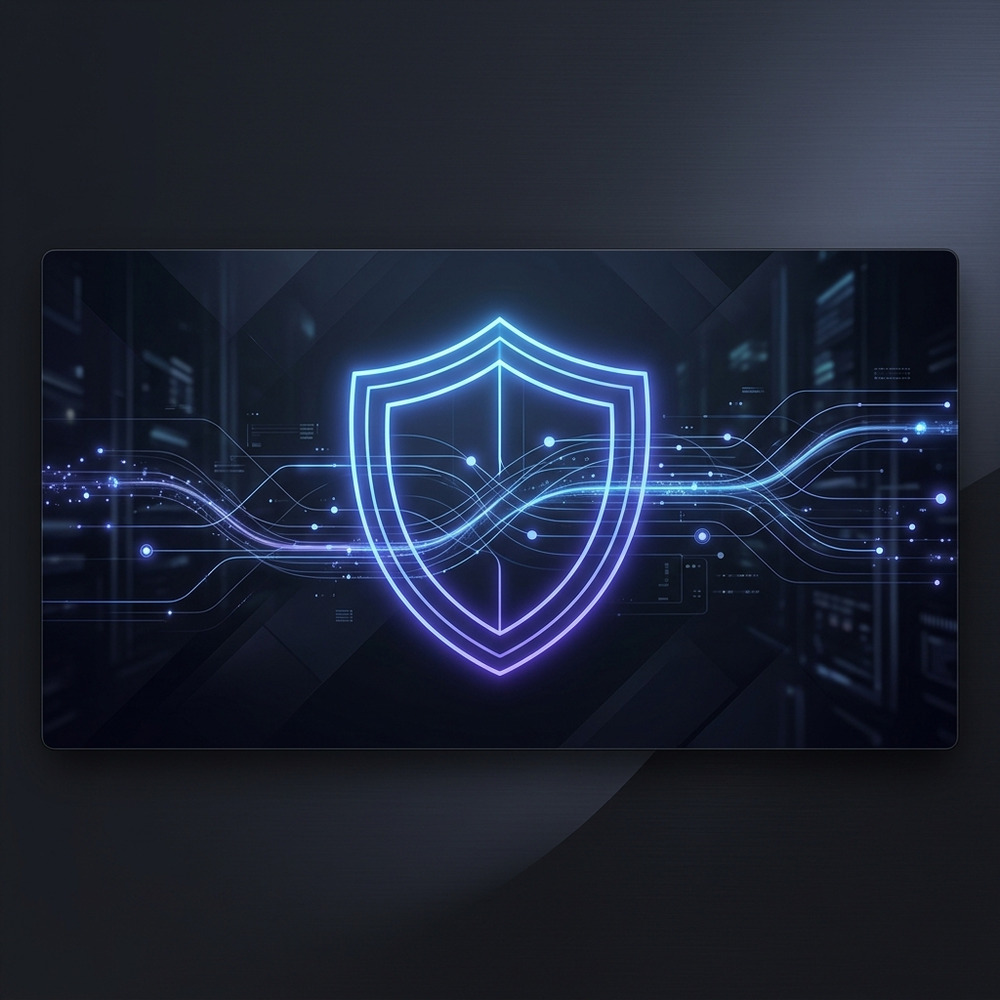

# Freenet (macOS)

<p align="center">
  
</p>

<p align="center">
  <a href="https://img.shields.io/badge/Platform-macOS%2013.0+%20(Universal)-apple?style=flat-square&logo=apple"></a>
  <a href="https://img.shields.io/badge/Sürüm-1.2.1-orange?style=flat-square"></a>
  <a href="https://img.shields.io/badge/Swift-5-F05138?style=flat-square&logo=swift&logoColor=white"></a>
  <a href="https://img.shields.io/badge/Lisans-MIT-green?style=flat-square"></a>
</p>

<h3 align="center">Ücretsiz. Açık kaynak. Niyet tabanlı. Sansür aşımı <em>veya</em> gerçek anonimlik — sen seçersin.</h3>

Freenet, macOS (Apple Silicon & Intel Universal Binary) için **sıfır yapılandırmalı**, native SwiftUI bir internet özgürlüğü aracıdır. Menü çubuğunda yaşar, tek tıkla bağlanır ve hız, IP maskeleme ile gerçek anonimlik arasındaki sınırı dürüstçe ayırır. **Yalnızca macOS.**

🇬🇧 **[English README](README.md)** · 📋 **[Yol Haritası](ROADMAP.md)** · 🛡️ **[Tehdit Modeli](docs/THREAT_MODEL.md)** · 🔧 **[Derleme Rehberi](docs/BUILD.md)**

---

## Üç Niyet (Dürüst Seçim)

Freenet **tek düğmede hem tam hız hem tam anonimlik** vaat etmez. Açık bir **niyet** seçersin:

| Niyet | Motorlar | Neyi korur | Neyi **korumaz** |
|-------|----------|------------|------------------|
| **Hızlı** | **sing-box** (`Hibrit Zırh`: sing-box + `ciadpi` veya saf TLS/TCP fragment) | Tam hat hızında DPI/SNI/HTTP-80 sansür aşımı + şifreli DoH DNS kalkanı (zararlı/reklam engel) + QUIC/BTK engel | IP gizlemez; anonimlik **yok** |
| **Dengeli** | **WARP** (`sing-box` yerel WireGuard varsayılan veya tam cihaz `wg-quick` L3 tünel) | IP maskeler, IP banlarını aşar, tünel içi DoH kalkanı, çoklu IP/port yedekleme (`500`/`4500`/`1701`/`2408`) + `MTU 1380` | **Anonim değildir** — Cloudflare gerçek IP ve hedefleri görür |
| **Maks. Gizlilik** | **Tor** (+ isteğe bağlı `obfs4`/`snowflake` köprüleri) | Canlı `check.torproject.org` doğrulamalı çok-sıçramalı gerçek anonimlik | Yüksek hız; bazı siteler Tor çıkışını engeller |

> **Gerçek anonimlik yalnızca Maks. Gizlilik (Tor) niyetindedir.**  
> WARP, **tek operatöre (Cloudflare) güven** modeliyle ücretsiz IP maskelemedir; anonimlik değildir.

---

## Öne Çıkan Özellikler (v1.2.0)

### Güçlendirilmiş Hızlı Mod (VPN'siz Tam Hat Hızı)
- **Hibrit Zırh (`sing-box 1081 → ciadpi 1082`)** *(varsayılan)*: `sing-box` tarafında şifreli DoH, `HTTPS`/`SVCB` + QUIC/UDP:443 engeli, `port 53` DNS kaçak koruması (`hijack-dns`) ve BTK/reklam IP reddi (`195.175.254.2`, `0.0.0.0/8`); `ciadpi` tarafında ise 3 kademeli otomatik DPI desync (`-r 1+s`, `-s 1+s`, `-d 1`, HTTP:80 Host koruması `-M h`, `-L 3` sıralama ve 1 saat IP önbelleği).
- **Ayarlar'da 3 Anti-DPI katmanı:** `Hibrit Zırh`, `TLS Record (Hızlı)`, `TCP Fragment (Sert DPI)`.
- **5 Şifreli DoH DNS Kalkanı + Otomatik Yedekleme:** Cloudflare Güvenlik (`1.1.1.2` zararlı engel), AdGuard Kalkan (`94.140.14.14` reklam+izleyici+zararlı engel), Cloudflare Hızlı (`1.1.1.1`), Quad9 (`9.9.9.9`) ve Google (`8.8.8.8`), `4096` DNS önbelleği ve `.local`/`.test`/LAN yerel geçişi.
- **Mixed Proxy (`SOCKS5 + HTTP + HTTPS`):** Tek yerel port (`127.0.0.1:1081`), dinamik ağ arayüzü algılama (`Wi-Fi`, `USB LAN`, `Ethernet`) ve LAN bypass listesi.

### İyileştirilmiş Dengeli Mod (Çift Motorlu WARP)
- **`sing-box WARP` *(varsayılan, önerilen)*:** Gömülü `sing-box` içinde native WireGuard (`127.0.0.1:1083`) — root gerektirmez, sistem `utun` yönlendirmesini bozmaz (yerel sunucuları ve `cloudflared` tünellerini koparmaz), `162.159.193.1` / `162.159.192.1` × `500`/`4500`/`1701`/`2408` üzerinde canlı `warp=on` doğrulamalı otomatik yedekleme + tünel içi şifreli DoH.
- **`Sistem Tüneli (wg-quick)`:** Proxy okumayan uygulamalar için tam cihaz L3 `utun` tüneli (`MTU 1380`, `PersistentKeepalive 25`, alternatif `162.159.193.1` ucu, DNS kalkanı uyumu ve açılışta `warp=on` kontrolü).

### Native macOS Mimarisi
- **Universal Binary (`arm64` + `x86_64`)** — Apple Silicon ve Intel Mac'ler için tek paket.
- **Sıfır alt-süreçli izleme:** `getifaddrs()`, `CFNetworkCopySystemProxySettings()` ve POSIX non-blocking TCP `connect()` ile düşük CPU/pil tüketimi.
- **Sıcak Mod Geçişi (Hot-Swap):** Bağlıyken bağlantıyı elle kapatmadan niyetler arası anında geçiş.
- **Güvenlik & Otomatik Güncelleme:** SHA-256 doğrulama (`CHECKSUMS.sha256`), uygulama içi **otomatik güncelleyici** (GitHub Releases `.zip` + `.sha256` doğrulaması, HTTPS alan adı kısıtı, atomik değişim + rollback), katı `DPIArgsValidator` + zorunlu `127.0.0.1` dinleme, daraltılmış `sudoers`, self-heal ve yetim proxy temizliği.

---

## Kaynaktan Kurulum ve Test

```bash
git clone https://github.com/Baro007/freenet.git
cd freenet/app
./Tests/run_tests.sh   # 88 saf mantık testi
./build.sh             # Universal macOS paketi: build/freenet.app
open build/freenet.app
```

**Gereksinimler:** macOS 13+, Xcode Command Line Tools (`swiftc`).

- **Hızlı:** Kurulumsuz hemen çalışır (`sing-box` ve `ciadpi` gömülü + SHA-256 doğrulamalı).
- **Dengeli (WARP):** `~/.config/wireguard/wgcf.conf` kullanır (Homebrew `wgcf` varsa otomatik oluşturur).
- **Maks. Gizlilik (Tor):** `tor` gerektirir (`brew install tor` veya `app/Resources/bin/tor`). İkili yoksa uygulama **bağlıymış gibi yalan söylemez**.

---

## Güvenlik ve Lisans

- Açık kaynak (MIT) — telemetri, analiz, hesap veya ücretli katman yoktur.
- Ayrıntılı analiz için [docs/THREAT_MODEL.md](docs/THREAT_MODEL.md) ve [docs/BUILD.md](docs/BUILD.md) belgelerine bakın.
- Lisans: MIT — [LICENSE](LICENSE).
